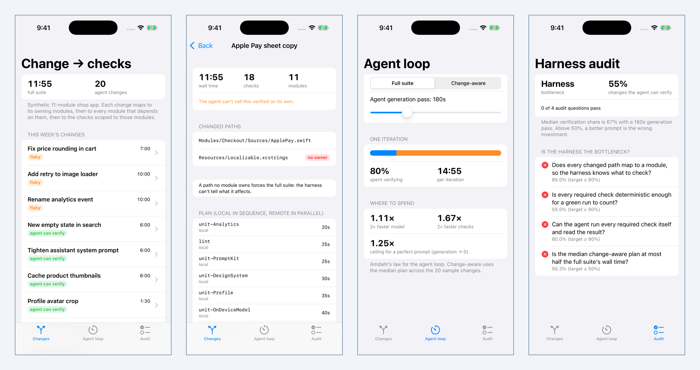
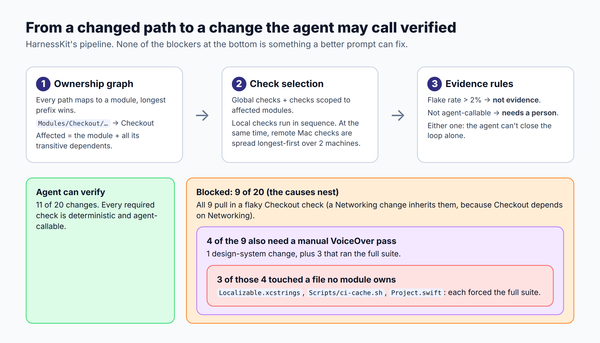
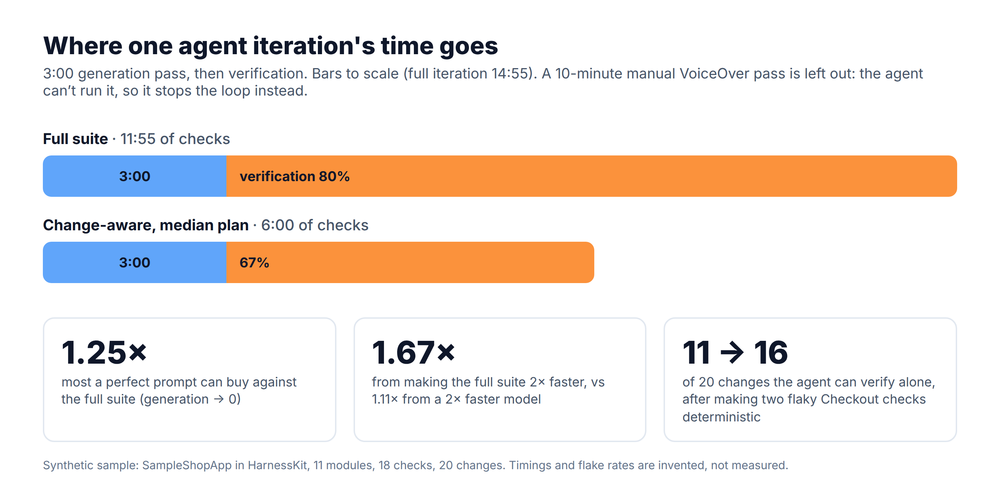

# HarnessKit

**Is your iOS team's agent loop waiting on the model, or on the harness?** A Swift package that maps each change to the checks it needs through an ownership graph, flags the checks an agent can't trust or can't run, and measures where an agent's loop time actually goes. Includes an iOS demo app.

Article: (added after publish)



## The idea

Pedro Piñera argues that compute is commoditising and the layer worth building is the harness on top of it ([Why Tuist should build the harness on top of compute](https://pepicrft.me/blog/tuist-harness-on-top-of-compute)). This package is my version of that harness for one iOS repo, small enough to read in one sitting:

1. **Ownership graph.** Every path belongs to a module (longest prefix wins). A change affects its modules plus everything that depends on them.
2. **Change → checks.** Checks are scoped to modules or global. A local lane runs its checks in sequence while, at the same time, remote macOS checks are spread longest-first over a pool of machines.
3. **Unowned paths fall back to the full suite.** If the harness can't say what a file affects, it has to run everything.
4. **Evidence rules.** A required check that flakes more than 2% of the time is *not evidence*. A check only a person can run or read is *human-only*. Either one means the agent can't call the change verified on its own.
5. **Amdahl for the agent loop.** `LoopModel` splits one iteration into generation and verification and tells you what a faster model or a perfect prompt can buy.



## What's in it

- `ModuleGraph`, `Module`: path ownership and the transitive dependents closure (cycle-safe), plus `unknownDependencies()` to catch a broken graph.
- `Check`, `CheckScope`, `Runner`: kind, scope, median seconds, local or remote Mac, flake rate, agent-callable.
- `VerificationPlanner` → `VerificationPlan`: affected modules, unowned paths, ordered steps, `notEvidence`, `humanOnly`, parallel local and remote lanes (LPT scheduling), `wallSeconds` (what the agent waits for), `humanSeconds`, `agentCanSelfVerify`.
- `LoopModel`: verification share, `speedup(generationFactor:verificationFactor:)`, `promptCeiling`.
- `HarnessAudit`: replays a week of changes and scores four questions (ownership, determinism, agent-callable, change-aware selection), then names the bottleneck: `.harness` or `.prompt`. On the sample, none of the four passes.
- `SampleShopApp`: a constructed, **synthetic** shop app with 11 modules, 18 checks and 20 agent changes. Timings and flake rates are invented to be plausible, not measured.

```swift
let planner = VerificationPlanner(graph: ModuleGraph(modules: modules), checks: checks)
let plan = planner.plan(changedPaths: ["Modules/Networking/Sources/Session.swift"])
plan.wallSeconds          // 600
plan.notEvidence.map(\.id) // ["snapshot-Checkout", "ui-checkout-journey"]
plan.agentCanSelfVerify   // false: Checkout depends on Networking and inherits its flaky checks

let audit = HarnessAudit(planner: planner, changes: week, generationSeconds: 180)
audit.bottleneck          // .harness
```

On the sample, with a 3-minute generation pass: the checks the agent can run take 11:55 for the full suite (a 10-minute manual VoiceOver pass is counted separately, as `humanSeconds`, because the agent can't wait for it, only stop). That makes 80% of one iteration verification, so a perfect prompt can make it at most 1.25× faster; a 2× faster model buys 1.11×, 2× faster checks 1.67×. Change-aware selection cuts the median plan to 6:00, and verification is still 67% of the loop. Only 11 of 20 changes can be verified by the agent alone. The 9 blocked ones nest: all 9 pull in one of two flaky Checkout checks (6 never touched Checkout), 4 of them also need the VoiceOver pass, and 3 of those 4 touched a path no module owns (`Resources/Localizable.xcstrings`, `Scripts/ci-cache.sh`, `Project.swift`), which forced the full suite. Make the two Checkout checks deterministic and it goes to 16 of 20. A second remote Mac cuts the median plan from 11:30 to 6:00; a third doesn't move it, because one 6-minute UI journey sets the floor.



## How to run it

```bash
git clone https://github.com/rajatslakhina/agent-harness-article-demo.git
cd agent-harness-article-demo
open Demo.xcodeproj   # pick an iPhone Simulator, then Build & Run (⌘R)
```

No other setup: `Demo.xcodeproj` uses the package in this repo through a local package reference. The Agent loop tab opens on the full suite, with a generation-time slider and a full-suite / change-aware switch.

Library only:

```bash
swift build && swift test
```

## Verification status

- `swift build -Xswiftc -warnings-as-errors` and `swift test` (27 tests, 0 failures) pass on Linux (Swift 6.1.2). The `library` CI job is configured to run them again on macOS.
- The `demo-on-simulator` CI job is configured to build `Demo.xcodeproj` for an iPhone Simulator, install and launch the app four times with a process-alive check, and commit the screenshots in `Demo/Screenshots/`. It is not a hand-run in local Xcode. (Status is updated here once CI has run.)

## License

MIT
